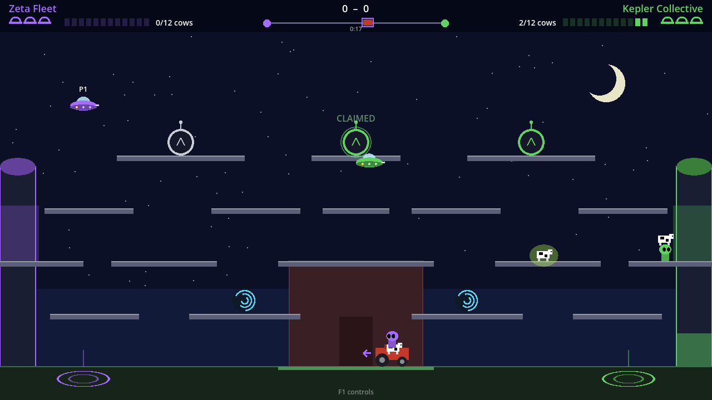

# Saucer Showdown

A team arcade brawler: two alien fleets fight over one farm, and there are three ways to win a map.

This is the **greybox prototype** (step 1 of the concept doc): one map, bots in every seat a human doesn't take, and all three win conditions working. Everything is drawn with primitives; there are no art or sound assets yet.



## Run it

Needs Godot 4.7 (standard build).

```bash
godot --path .
```

Or open the folder in the Godot editor and press F5.

## How to win a map

| Win | Goal |
| --- | --- |
| Military | Shoot down the rival Overlord 3 times |
| Economic | Bank 12 cows in your silo |
| Tractor | Ride the farmer's tractor into your crop circle |

A match is best of 3 maps.

## Controls

| | Move | Jump | Fire / use | Tractor beam | Switch unit | Join |
| --- | --- | --- | --- | --- | --- | --- |
| Player 1 | WASD | Space | J | K | Q | always in |
| Player 2 | Arrows | Up | . | / | Enter | Enter |
| Gamepad | Stick / D-pad | A | X | B | Y | Start |

- **Overlord (saucer):** flies freely. Fire shoots where you're moving. Hold the beam over a cow or a teammate to lift it, and fly it wherever you like; you're slow while beaming. Touch a Probe Station to claim it.
- **Grey:** runs and jumps; down + jump drops through a platform. Touching a cow picks it up. Carry it to your silo ledge to bank it. Press use next to the tractor to ride it (use or jump to hop off).
- **Probe Station** (upper decks): stand in it with a cow to become a warrior with a ray gun and a short hover. Warriors can't carry cows or ride the tractor. Enemy-claimed stations are locked.
- **Wormhole** (lower decks): stand in it with a cow for a permanent speed boost.
- **Probed cows:** a cow the Overlord beams through a Probe Station glows, is slower to carry, and banks for 2.
- **Cow heists:** an enemy grey that touches a cow in your beam takes it.
- **Saucer wrecks:** a downed saucer stays where it falls as a platform until its Overlord respawns.

Other keys: F1 controls, F2 team size (2v2 or 4v4), F3 hand Player 1's seat to a bot and watch, F5 install an update when one is offered, R restart, Esc pause.

## Layout

```
scripts/
  main.gd              game shell: seats, score, fixed-tick loop
  sim/                 the whole game, with no nodes or rendering
    config.gd          every tuning number
    map_data.gd        the night-farm map and the bots' platform graph
    entities.gd        unit, cow, bolt, wreck, tractor data
    sim.gd             rules and physics; step() advances one tick
    bot.gd             bot brains (write the same inputs a human does)
  input/local_input.gd keyboards and gamepads
  update/updater.gd    update check and self-install from GitHub Releases
  view/                greybox drawing and the HUD
tests/
  test_sim.gd          headless tests for every rule and win condition
  test_updater.gd      headless tests for version ordering and asset choice
  bot_stats.gd         balance probe: how bot-only matches end
export_presets.cfg     Linux and Windows export settings
.github/workflows/
  release.yml          builds and attaches both platforms to a release
```

The simulation is deterministic and separate from rendering: inputs in, one fixed tick out. That is what makes it testable headless, and it is the shape rollback netcode will need later.

## Tests

```bash
godot --headless --path . --script tests/test_sim.gd
```

```bash
godot --headless --path . --script tests/test_updater.gd
```

```bash
godot --headless --path . --script tests/bot_stats.gd -- 3
```

## Releases and updates

Publishing a GitHub release runs `.github/workflows/release.yml`. It stamps the release's tag into the game as its version, runs the tests, exports Linux and Windows builds, and attaches them to the release as `saucer-showdown-<tag>-linux.zip` and `saucer-showdown-<tag>-windows.zip`. Each zip holds one self-contained executable.

Use tags like `v0.2.0`. Running the workflow by hand from the Actions tab builds the same zips as an artifact without touching a release.

A released build checks the repo's latest release when it starts. If that tag is newer than its own, the HUD offers the update; F5 downloads the zip for the platform, checks it against the SHA-256 GitHub publishes for the asset, installs it over the running game and restarts. Pre-releases and drafts are never offered.

- The check is off in the editor, in `dev` builds (anything not built by the workflow) and in builds exported with a `steam` feature tag, since Steam updates its own installs.
- The releases must be publicly readable. While this repo is private the check gets a 404 and stays silent.
- On Windows the swap is done by a small script after the game exits, because a running `.exe` can't be replaced.

To rehearse an update against a local feed, debug exports accept `-- --update-feed=<url>` (a JSON file shaped like GitHub's "latest release" reply) and `-- --update-auto` (install without waiting for F5).

## Known rough edges

- Bot balance: bot-only matches currently all end in Military wins after roughly 1–2 minutes, short of the 3–5 minute target. Economies usually reach 5–11 of 12 by then.
- The Windows half of the updater has not been run on Windows yet.
- No audio, no final art, no menus, no online play.
