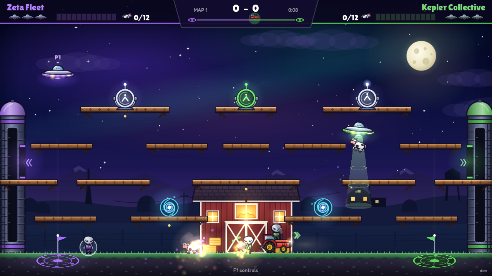

# Saucer Showdown

A team arcade brawler: two alien fleets fight over one farm, and there are three ways to win a map.

This is the **prototype** (step 1 of the concept doc): one map, bots in every seat a human doesn't take, and all three win conditions working. The art is a first pass of hand-written SVG sprites; there is no sound yet.



## Run it

Needs Godot 4.7 (standard build).

```bash
godot --path .
```

Or open the folder in the Godot editor and press F5.

The game opens on the home screen, with bots playing behind it:

- **Play online** hosts a room or joins one by its code (see [Play online](#play-online)).
- **Play local** picks a team size (2v2, 3v3 or 4v4) and starts a match on this machine.
- **2nd player** (on the local setup screen and in the online lobby) lets more players at this machine join. It's off by default, so a stray Enter or gamepad press can't add a player: while it's off, every keyboard and gamepad controls Player 1. The choice is saved.
- **Settings** has sound (master, music and effects volume, mute), display (windowed or fullscreen, resolution, frame rate limit, VSync, a frame rate counter) and controls (rebind either keyboard player's keys). Settings are saved in `user://settings.cfg`. There is no audio yet, so the volume settings are ready for when there is.

When a match is decided, everyone goes back to the lobby (online) or the local setup screen, after a key press or 10 seconds.

## How to win a map

| Win | Goal |
| --- | --- |
| Military | Shoot down the rival Overlord 3 times (each saucer takes 3 hits) |
| Economic | Bank 12 cows in your silo |
| Tractor | Ride the farmer's tractor into your crop circle |

A match is best of 3 maps.

## Controls

| | Move | Jump | Fire / use | Tractor beam | Switch unit | Join |
| --- | --- | --- | --- | --- | --- | --- |
| Player 1 | WASD | Space | J | K | Q | always in |
| Player 2 | Arrows | Up | . | / | Enter | Enter (with 2nd player on) |
| Gamepad | Stick / D-pad | A | X | B | Y | A (with 2nd player on) |

- **Overlord (saucer):** flies freely. Fire shoots where you're moving. Hold the beam over a cow or a teammate to lift it, and fly it wherever you like; you're slow while beaming. Touch a Probe Station to claim it.
- **Grey:** runs and jumps; down + jump drops through a platform. Touching a cow picks it up. Carry it to your silo ledge to bank it. Press use next to the tractor to ride it (use or jump to hop off).
- **Probe Station** (upper decks): stand in it with a cow to become a warrior with a ray gun and a short hover. Warriors can't carry cows or ride the tractor. Enemy-claimed stations are locked.
- **Wormhole** (lower decks): stand in it with a cow for a permanent speed boost.
- **Probed cows:** a cow the Overlord beams through a Probe Station glows, is slower to carry, and banks for 2.
- **Cow heists:** an enemy grey that touches a cow in your beam takes it.
- **Saucer damage:** a saucer takes 3 hits to bring down. It smokes after one and sparks after two; the bar beside its lives shows what's left. A fresh saucer is back to full.
- **Saucer wrecks:** a downed saucer stays where it falls as a platform until its Overlord respawns.

Other keys: Esc (or Start on a gamepad) opens the in-game menu (resume, restart, settings, back to the lobby or home), F1 controls, F3 hand Player 1's seat to a bot and watch (local games), F5 check for an update (and install it when one is offered). Keyboard keys and gamepad buttons can be changed in Settings (every gamepad shares one set; the left stick always moves, and Start always opens the menu).

## Play online

Pick **Play online** and type your name. One player picks **Host a game** and gets a five-letter room code; friends type it in and press **Join**. Games go through the Saucer Showdown relay server (`saucer.drewburr.com`), so nobody has to forward ports.

Everyone lands in the **lobby**, which shows the room code and who is on which team. Newcomers go on the smaller team; anyone can switch to a team with an open seat, and rename themselves. The host picks 2v2, 3v3 or 4v4 and starts the match. A room holds as many players as the team size has seats (4, 6 or 8); anyone who tries to join a full room is told so, and the lobby says when it's full. The host can't pick a size too small for the players already in.

In the match, each machine's first keyboard plays the seat its player picked; with **2nd player** turned on in the lobby, anyone else at that machine joins with Enter or A, just like couch play. Bots fill every empty seat, and take over when someone leaves. Someone who joins while a match is on goes straight into a free seat. When the match is decided, everyone goes back to the lobby.

- Everyone needs the same build; a mismatched one is turned away with the two versions named.
- Only the host can pause (opening the menu with Esc or Start pauses everyone), end the match, or change the team size. Anyone can move the win banner on.
- Online play uses rollback netcode: your own moves show at once (after 2 ticks, about 33 ms, of input delay) and other players' are predicted, then corrected when their real input arrives. A correction can make a remote player jump a little. The game only waits ("Waiting for players…") if a connection falls more than 200 ms behind.
- The ping shown is the real round trip to the host, through the relay.
- From the command line (after `--`): `--join=CODE` joins a room; `--relay=HOST[:PORT]` uses a different relay (say, one running locally); `--lag=MS` delays every packet this machine sends, to fake a slow connection; `--local[=GREYS]` skips the menus and starts a local match (1, 2 or 3 greys a team).
- Direct play without the relay, for a LAN or development: `--host` (with `--port=N`) hosts on this machine, and `--join=ADDRESS[:PORT]` joins it. The host needs UDP port 24680 reachable.

## Layout

```
scripts/
  main.gd              game shell: menus or match, lobby, seats, score, fixed-tick loop
  settings.gd          saved settings (name, sound, display, key bindings) and applying them
  sim/                 the whole game, with no nodes or rendering
    config.gd          every tuning number
    map_data.gd        the night-farm map and the bots' platform graph
    entities.gd        unit, cow, bolt, wreck, tractor data
    sim.gd             rules and physics; step_frame() advances one tick; snapshots
    bot.gd             bot brains (write the same inputs a human does)
    input_frame.gd     one tick of every unit's input, packed into bytes
    fmath.gd           sin/cos that give the same bits on every platform
  input/local_input.gd keyboards and gamepads, packed into one packet per tick
  net/net_peer.gd      game message protocol, and the direct ENet transport
  net/relay_link.gd    the same, through the relay server
  update/updater.gd    update check and self-install from GitHub Releases
  view/
    arena_view.gd      draws the arena from sim state: sprites, animation, particles, glow
    hud.gd             top bar, win banner, controls overlay, online status
    art.gd             loads and team-colours the sprites, and the fonts
  ui/
    menus.gd           home, local setup, play online, the lobby, the in-game menu
    settings_page.gd   the sound / display / controls tabs
    ui_kit.gd          the menus' theme and widget builders
assets/
  sprites/             SVG art, one file per sprite
  fonts/               Lilita One and Fredoka (SIL Open Font License)
tools/
  screenshot.gd        runs the game and saves screenshots
  menu_shots.gd        saves a screenshot of every menu page
  sprite_sheet.gd      saves every sprite, in both team colours, on one sheet
  sim_trace.gd         plays fixed matches and writes the sim's checksums
tests/
  test_sim.gd          headless tests for every rule and win condition
  test_updater.gd      headless tests for version ordering and asset choice
  test_net.gd          host and clients over loopback (and with fake lag), checked tick by tick; the lobby
  test_input.gd        gamepad bindings, read and rebound on the settings page; F1 help naming them
  bot_stats.gd         balance probe: how bot-only matches end
relay/                 the relay server and its Docker image (see relay/README.md)
  relay_server.gd      rooms, codes, forwarding
  relay_protocol.gd    the wire format and the relay's address; the game loads it too
  relay_client.gd      a game's side of the relay: host, join, send; the game uses it too
  example/chat.gd      the smallest game that uses the relay, for other games to copy
  relay_probe.gd       checks a running relay end to end
export_presets.cfg     Linux and Windows export settings
.github/workflows/
  release.yml          builds and attaches both platforms to a release
  determinism.yml      checks Linux and Windows simulate identically
  relay-image.yml      builds, smoke-tests and pushes the relay's image when relay/ changes
```

The simulation is deterministic and separate from rendering: inputs in, one fixed tick out. That is what makes it testable headless, and it is the shape rollback netcode needs.

## How online play works

Offline and online run the same loop in `main.gd`. Each machine samples its local devices into one input packet per tick and hands it to the host (offline, the machine is its own host). Once the host has everyone's input for a tick, it applies seat changes, packs the inputs into a confirmed `InputFrame`, and sends it to every client.

Each machine runs its sim at the "present", ahead of the last confirmed frame. For ticks not yet confirmed it predicts: its own players' input is known, and everyone else is assumed to keep doing what they last did. When a confirmed frame disagrees with what was predicted, it loads the saved state from that tick and replays up to the present. Every machine therefore ends up with the identical match. Offline, every frame is confirmed at once and nothing is predicted.

- **Time sync:** the host measures how early each client's inputs arrive and tells it (`SYNC`). The client gains or drops a tick every other frame until its inputs arrive about a tick early. In practice a client runs ahead of the host by half the round trip, the host almost never rolls back, and each client predicts about one round trip ahead.
- **Limits:** the present never runs more than 12 ticks (200 ms) past the confirmed frames; beyond that it waits.
- **Effects:** a replayed tick doesn't repeat the effects it already showed. The win banner and score wait for the win to be confirmed.

- **Late joiners** get a snapshot of the host's sim, then the frames from there on.
- **Desyncs:** every second each client sends its checksum; if it doesn't match the host's, the host sends that client its current state and it carries on.
- **Mismatched builds:** a client sends a fingerprint (the checksum of a short bot match), so any change to the sim or tuning is caught when it connects.

The sim pieces that make this possible:

- **A match is its seed plus its input frames.** `Sim.step_frame()` takes one `InputFrame` per tick: 5 bytes per unit (stick axes quantised to a signed byte, plus button bits). A unit flagged `BOT` is driven by the sim's own bot, whose seed comes from the match seed, so bots need no network traffic and switching a seat between human and bot is just a different frame.
- **Rewind:** `save_state()` and `load_state()` snapshot everything, bots included. Loading reuses objects with the same id, so the view's animations survive a rollback.
- **Desync check:** `checksum()` is a 32-bit hash of the state, for peers to compare.
- **Same bits everywhere:** the sim uses only `+ - * /`, `sqrt` and `floor`, which IEEE 754 defines exactly. Anything else (sin, cos, rotations) goes through `fmath.gd`. The Determinism workflow plays fixed matches on Linux and Windows and fails if their checksums ever differ. Keep new sim code to those operations too.

A 4v4 tick with bots costs about 0.2 ms, so rewinding and replaying 7 ticks every frame takes under 2 ms.

## Art

Every sprite is a plain SVG in `assets/sprites`, so it can be edited in Inkscape or any text editor. They are imported as "Keep File" and shipped as-is; `scripts/view/art.gd` rasterises them at 2× when the game starts.

- **Team colours:** parts drawn in magenta are recoloured per team: `#ff00ff` becomes the team colour, `#800080` its shade and `#ff80ff` its highlight.
- **Pivots:** each file's comment says which point sits on the sim's position (usually the hitbox centre) and which way it faces. Legs, arms, wheels, rings and lights are drawn in code so they can animate.
- **Not supported:** the SVG renderer ignores `<pattern>` fills, so repeat shapes by hand.

To check art changes without playing, render a sprite sheet or screenshots (screenshots need a display; use `xvfb-run -a` on a headless machine):

```bash
godot --headless --path . --script tools/sprite_sheet.gd -- sprites.png
```

```bash
godot --path . --script tools/screenshot.gd -- shots 3 12 30
```

```bash
godot --path . --script tools/menu_shots.gd -- shots
```

## Tests

```bash
godot --headless --path . --script tests/test_sim.gd
```

```bash
godot --headless --path . --script tests/test_updater.gd
```

```bash
godot --headless --path . --script tests/test_net.gd
```

```bash
godot --headless --path . --script tests/test_input.gd
```

```bash
godot --headless --path . --script tests/bot_stats.gd -- 3
```

```bash
godot --headless --path . --script tools/sim_trace.gd -- trace.txt
```

```bash
godot --headless --path . --script res://relay/relay_probe.gd -- 127.0.0.1:24680
```

## Relay server

Online games go through a small relay so players behind home routers can connect: the host opens a room and gets a code, friends join with it, and the relay passes packets between them. Other games can use it too, the public one or their own: rooms belong to a game id. It lives in [`relay/`](relay/README.md), which has everything about using, running, building and checking it.

- **Image:** `ghcr.io/drewburr-labs/saucer-showdown-relay`, rebuilt by CI only when something in `relay/` changes.
- **Run it:** `docker run -p 24680:24680/udp ghcr.io/drewburr-labs/saucer-showdown-relay` (UDP must be reachable).
- **Address:** the game connects to `saucer.drewburr.com:24680`.

## Releases and updates

Publishing a GitHub release runs `.github/workflows/release.yml`. It stamps the release's tag into the game as its version, runs the tests, exports Linux and Windows builds, and attaches them to the release as `saucer-showdown-<tag>-linux.zip` and `saucer-showdown-<tag>-windows.zip`. Each zip holds one self-contained executable.

Use tags like `v0.2.0`. Running the workflow by hand from the Actions tab builds the same zips as an artifact without touching a release.

A released build checks the repo's latest release when it starts, and again whenever you press F5 with nothing to install (the HUD says whether it is up to date). If that tag is newer than its own, the HUD offers the update; F5 then downloads the zip for the platform, checks it against the SHA-256 GitHub publishes for the asset, installs it over the running game and restarts. If that fails (say the release's builds are still being uploaded), F5 asks GitHub again and installs whatever it finds. Pre-releases and drafts are never offered.

- The check is off in the editor, in `dev` builds (anything not built by the workflow) and in builds exported with a `steam` feature tag, since Steam updates its own installs.
- The releases must be publicly readable. While this repo is private the check gets a 404 and stays silent.
- On Windows the swap is done by a small script after the game exits, because a running `.exe` can't be replaced.

To rehearse an update against a local feed, debug exports accept `-- --update-feed=<url>` (a JSON file shaped like GitHub's "latest release" reply) and `-- --update-auto` (install without waiting for F5).

## Known rough edges

- Bot balance: since saucers take 3 hits, bot-only matches mostly end in Economic wins after roughly 2–3 minutes, still short of the 3–5 minute target.
- The Windows half of the updater has not been run on Windows yet.
- No audio yet (the volume settings are wired up for when there is). The art is a first pass, not final.
- Online: all games go through the one relay, so players far from it get a longer ping. There's no matchmaking: you share a room code.
- Online: a rollback correction moves remote players instantly instead of smoothing them into place, and an effect from a wrong prediction (say, a hit that didn't happen) stays on screen.
